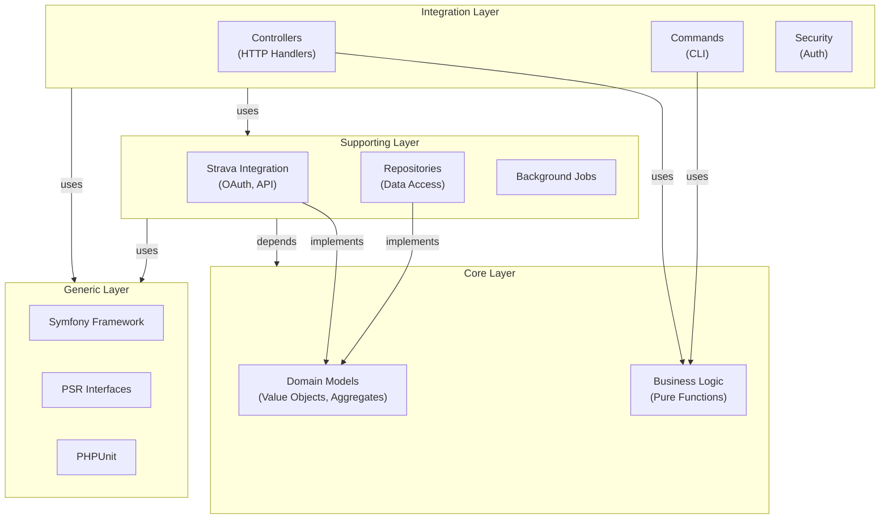
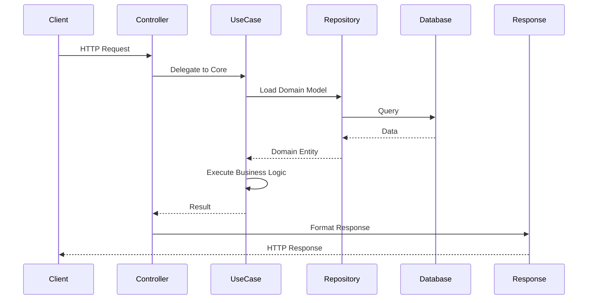

# Software Architecture Skill

When asked for designing, validating, or documenting architecture, follow these guidelines.

## Core Principles

1. **Clean Architecture** - Organize code into layers based on dependency direction
2. **Hexagonal Architecture** - Isolate business logic from frameworks and external dependencies
3. **SOLID Principles** - Single Responsibility, Open/Closed, Liskov Substitution, Interface Segregation, Dependency Inversion
4. **Dependency Inversion** - High-level modules should not depend on low-level modules; both should depend on abstractions

## Layer Structure (Momentum Pattern)

### Core Layer (`App\Momentum`)
- **Purpose**: Pure domain logic and business rules
- **Dependencies**: None (isolated from frameworks)
- **Contains**:
  - Domain models and value objects
  - Business logic and calculations
  - Domain-specific interfaces and contracts
- **Rules**:
  - No external dependencies (no Symfony, no database, no HTTP)
  - All logic should be framework-agnostic
  - Focus on testability and clarity

### Supporting Layer
- **Purpose**: Infrastructure and integration concerns
- **Dependencies**: Can depend on Core + Generic layers
- **Contains**:
  - `App\Strava`: External API integration (OAuth2, synchronization)
  - `App\Async`: Background job handling
  - `App\Listener`: Event subscribers
  - `App\Repository`: Data access layer
  - `App\Twig`: View-specific helpers
- **Rules**:
  - Implement domain interfaces (adapters)
  - Handle external service communication
  - Never depend on controllers or other integration concerns

### Integration Layer (Controllers, Commands, Security, Entities)
- **Purpose**: Framework integration and HTTP/CLI interfaces
- **Dependencies**: Can depend on Core, Supporting, Generic layers
- **Contains**:
  - `App\Controller`: HTTP endpoint handlers
  - `App\Command`: CLI commands
  - `App\Security`: Authentication/authorization
  - `App\Entity`: Doctrine ORM entities (database mapping)
  - `App\Middleware`: HTTP middleware
- **Rules**:
  - Translate HTTP requests/CLI input to domain operations
  - Delegate business logic to Core layer
  - Handle framework concerns (routing, validation, responses)

### Generic Layer
- **Purpose**: Framework and standard library abstractions
- **Dependencies**: Isolated (not depends by anyone specifically)
- **Contains**:
  - Symfony framework classes
  - PSR interfaces
  - PHPUnit testing framework
  - Standard library components
- **Rules**:
  - Used by other layers but not tightly coupled to
  - Provides infrastructure abstractions

### Test Layer (`App\Tests`)
- **Purpose**: Unit tests validating business logic
- **Dependencies**: Can depend on all layers
- **Contains**:
  - `App\Tests\Unit`: Unit tests for Core and Supporting layers
  - Test fixtures and helpers
- **Rules**:
  - Focus on testing Core layer behavior
  - Use PHPUnit with strict settings
  - Maintain high code coverage for Core layer

## Deptrac Validation

### What is Deptrac?

Deptrac is a static code analyzer that enforces your architecture rules by validating layer dependencies. It ensures code follows your defined layer structure.

### Running Architecture Validation

```bash
# Full QA suite (includes architecture check)
make qa

# Architecture check only
make arch
```

### Configuring Deptrac Rules

Rules are defined in `app/deptrac.yaml` and specify which layers can depend on which:

```yaml
ruleset:
  Core: ~                    # Core depends on nothing
  Generic: ~                 # Generic depends on nothing
  Supporting:
    - Core                   # Supporting can depend on Core + Generic
    - Generic
  Tests:
    - Core                   # Tests can depend on everything
    - Generic
    - Supporting
```

### Fixing Architecture Violations

When `make arch` fails:

1. **Identify the violation** - Deptrac output shows forbidden dependencies
2. **Determine the root cause**:
   - Is the dependency necessary for business logic?
   - Can it be moved to a different layer?
   - Should the layer classification change?
3. **Refactor to resolve**:
   - Extract Core logic if a Core class depends on Supporting
   - Use dependency injection and interfaces
   - Move classes to appropriate layers
4. **Validate the fix** - Run `make arch` again

## Documentation with MkDocs and Mermaid

### Adding Architecture Diagrams

Use Mermaid diagrams to visualize architecture. Supported diagram types:

#### Layer Dependency Diagram



#### Request Flow Diagram



### MkDocs Configuration

MkDocs is configured to support Mermaid diagrams via `pymdownx.superfences`:

```yaml
markdown_extensions:
  - pymdownx.superfences:
      custom_fences:
        - name: mermaid
          class: mermaid
          format: !!python/name:pymdownx.superfences.fence_code_format
```

### Writing Architecture Documentation

1. **Use Markdown** with clear section hierarchy
2. **Add Mermaid diagrams** for visual understanding
3. **Include code examples** showing patterns and antipatterns
4. **Link to related documentation** for navigation
5. **Update nav in mkdocs.yaml** when adding new pages

## Common Patterns

### Creating a New Feature

1. **Define the business logic in Core** (value objects, domain services)
2. **Create interfaces** that Core layer expects
3. **Implement adapters in Supporting** layer (repositories, external service clients)
4. **Create a use case service** that orchestrates Core + Supporting
5. **Expose via Controller or Command** in Integration layer
6. **Write tests** validating Core behavior
7. **Run `make arch`** to ensure no violations

### Adding External Service Integration

1. **Design domain models** representing the integration (Core)
2. **Create an interface** in Core for what the service provides
3. **Implement the adapter** in Supporting layer (e.g., `App\Strava\Client`)
4. **Use dependency injection** to provide the adapter
5. **Keep Core logic free** of HTTP/API details

### Refactoring Violations

If a class violates layer rules:

1. Extract pure business logic to Core
2. Move framework dependencies to Supporting/Integration
3. Use dependency injection for decoupling
4. Validate with `make arch`

## Validation Checklist

- [ ] Business logic is in Core layer (no framework dependencies)
- [ ] Supporting layer only depends on Core + Generic
- [ ] Integration layer only depends on Supporting + Generic
- [ ] All public interfaces are abstracted (depend on contracts)
- [ ] Tests validate Core behavior with high coverage
- [ ] Architecture passes Deptrac validation (`make arch`)
- [ ] Documentation is updated with diagrams
