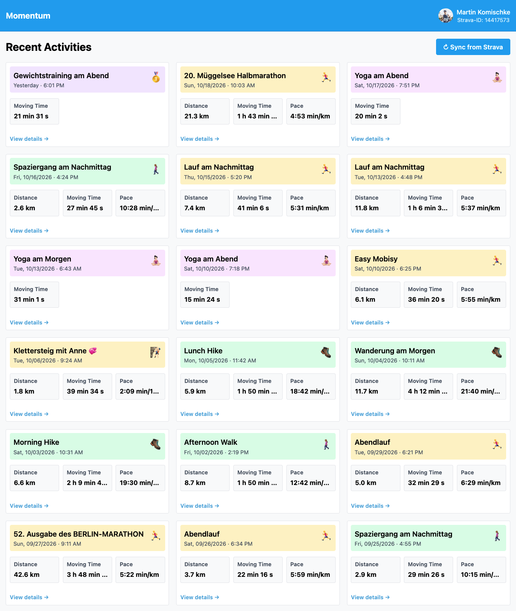
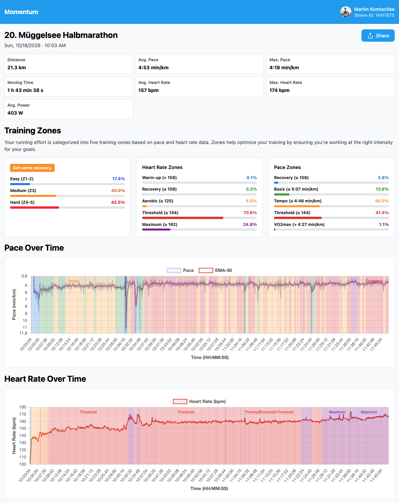

# Momentum

<p align="center">
  
</p>

<p align="center">
  <strong>Smart Activity Analytics</strong>
</p>

---

## Overview

**Momentum** transforms your Strava activity data into actionable insights. Real-time activity tracking, moving averages, training zone analysis, and performance metrics help you understand your training progress and optimize your goals.

### ✨ Key Features

- 📊 **Real-time Sync** - Automatic synchronization with Strava API
- 📈 **Performance Analytics** - Moving averages, pace trends, and effort analysis
- 🎯 **Training Zones** - Heart rate and pace zone classification
- ❤️ **Heart Rate Analysis** - Max, average, and zone-based metrics
- 📍 **Activity Details** - Complete activity info with streaming data (elevation, splits)
- 🔐 **Secure OAuth2** - Direct Strava integration with secure token management
- ☁️ **Cloud Native** - Kubernetes-ready with Helm deployment

---

## Screenshots

### Activity Dashboard
Browse all your activities with key metrics at a glance.



### Activity Analysis
Detailed performance analysis with training zones and time-based graphs.



---

## Tech Stack

| Component | Technology |
|-----------|------------|
| **Backend** | Symfony 8 + PHP 8.4 |
| **Database** | MySQL 8.4 |
| **Cache** | Valkey (Redis-compatible) |
| **Frontend** | Twig templates + Tailwind CSS |
| **Deployment** | Kubernetes + Helm |
| **External API** | Strava OAuth2 |

**Architecture**: Clean architecture with layered design, enforced via Deptrac.

---

## Quick Start

### Development

**Prerequisites:** Docker, Docker Compose, Make

1. **Get Strava API credentials:**
   - Go to [Strava Settings > API](https://www.strava.com/settings/api)
   - Create a new app and note your Client ID & Secret

2. **Setup environment:**
   ```bash
   cp .env.dist .env.local
   # Edit .env.local with your Strava credentials:
   # STRAVA_CLIENT_ID=your_client_id
   # STRAVA_CLIENT_SECRET=your_client_secret
   # STRAVA_REDIRECT_URI=http://localhost:8080/exchange-token
   ```

3. **Start the stack:**
   ```bash
   make boot      # First time: builds & starts everything
   make up        # Subsequent runs
   ```

4. **Access the app:**
   - Web UI: http://localhost:8080
   - Database: http://localhost:8085 (Adminer - user: `root`, password: `secret`)

5. **Authorize Strava:**
   - Click "Connect with Strava" on the login page
   - Grant permissions
   - Sync your activities

### Production

**Prerequisites:** Kubernetes cluster (K3s, EKS, GKE, etc.), kubectl, Helm 3+

Momentum deploys on Kubernetes with automatic HTTPS via Let's Encrypt (DNS-01 challenge).

#### Quick Deploy

```bash
# 1. Build and push Docker image
docker build -f build/Dockerfile.app -t <your-registry>/momentum:latest .
docker push <your-registry>/momentum:latest

# 2. Install with Helm
KUBECONFIG=/etc/rancher/k3s/k3s.yaml helm install momentum ./helm/momentum \
  --set-string app.image=<your-registry>/momentum:latest \
  --set-string app.secret="$(openssl rand -hex 32)" \
  --set-string strava.clientId=YOUR_CLIENT_ID \
  --set-string strava.clientSecret=YOUR_CLIENT_SECRET \
  --set-string strava.redirectUri=https://www.your-domain.com/momentum/exchange-token \
  --set-string ingress.enabled=true \
  --set-string ingress.hostname=www.your-domain.com
```

**Complete guide:** See [Operations > Deployment](./mkdocs/docs/operations/deployment.md)

---

## Development Guide

### Project Structure

```
app/
├── bin/console                 # Symfony CLI
├── src/
│   ├── Momentum/              # Core business logic (clean architecture)
│   ├── Strava/                # Strava API integration
│   ├── Command/               # Console commands
│   ├── Controller/            # HTTP endpoints
│   ├── Entity/                # Doctrine ORM models
│   ├── Repository/            # Data access layer
│   └── Security/              # Authentication & authorization
├── config/                     # Service definitions, routing
├── templates/                  # Twig templates
├── tests/Unit/                # Unit tests
└── migrations/                # Database migrations
```

### Common Tasks

**Run tests:**
```bash
make test          # Run PHPUnit tests
make qa            # Full QA suite (tests + lint + static analysis)
```

**Code style:**
```bash
make cs            # Fix code style (PHP-CS-Fixer)
make sa            # Static analysis (PHPStan level 8/8)
make arch          # Architecture validation (Deptrac)
```

**Database:**
```bash
make create-database    # Create database
make create-schema      # Create tables from entities
make shell              # Open app container shell
```

**Services:**
```bash
make up                 # Start stack
make down               # Stop stack
make logs               # Follow logs
make shell              # Access app container
```

### Testing

- **Unit tests** in `tests/Unit/` using PHPUnit
- **Strict mode**: Fails on deprecations, notices, warnings
- **Coverage**: Includes `src/` directory
- **Run single test:** `docker compose run --rm composer bin/phpunit tests/Unit/SomeTest.php`

### Architecture

The app follows **clean architecture** principles with enforced layer boundaries:

```
┌─────────────────────────────────────┐
│    Integration Layer (HTTP/CLI)     │
│  Controllers, Commands, Middleware  │
└─────────────────────────────────────┘
              ↓ depends on
┌─────────────────────────────────────┐
│   Supporting Layer (External APIs)  │
│  Strava OAuth, Caching, Persistence │
└─────────────────────────────────────┘
              ↓ depends on
┌─────────────────────────────────────┐
│      Core Layer (Business Logic)    │
│  Moving Averages, Performance Math  │
└─────────────────────────────────────┘
```

**Validation:** `make arch` enforces these rules with Deptrac.

---

## API & Features

### Strava Integration

- **OAuth2 Flow** - Secure user authorization
- **Token Caching** - Local persistence with auto-refresh
- **Activity Sync** - Background sync of activities
- **Stream Data** - Elevation, pace, and power metrics

### Performance Analytics

- **Moving Averages** - Configurable window for trend analysis
- **Training Zones** - Heart rate and pace zone classification
- **Pace/Heart Rate** - Min, max, and average metrics
- **Activity Classification** - By type (run, walk, yoga, etc.)

### Data Persistence

- **MySQL** for relational data (users, activities, metrics)
- **Valkey** for caching (OAuth tokens, activity streams)
- **Database migrations** via Doctrine

---

## Configuration

### Environment Variables

**Development** (`.env` + `.env.local`):
```
APP_ENV=dev
DATABASE_URL=mysql://root:secret@db:3306/app
STRAVA_CLIENT_ID=your_id
STRAVA_CLIENT_SECRET=your_secret
STRAVA_REDIRECT_URI=http://localhost:8080/exchange-token
```

**Production** (Kubernetes secrets):
```
APP_ENV=prod
SECURE_COOKIE=true
CACHE_URL=valkey://redis:6379
# ... plus all secrets in Kubernetes Secret resource
```

### Rate Limiting

The API includes two-tier rate limiting:
- **Per-IP**: 40 requests/10 minutes + 5 tokens/30 seconds
- **Global**: 200 tokens/minute (protects from DDoS)

See [Operations > Rate Limiting](./mkdocs/docs/operations/rate-limiting.md) for details.

---

## Deployment

### Local Development

```bash
# Complete setup
make boot

# Check health
curl http://localhost:8080
curl http://localhost:8080/health/ready
```

### Production (Kubernetes)

**Quick start:**
1. Prepare Kubernetes cluster with Traefik ingress controller
2. Configure DNS for your domain
3. Use Helm to deploy (see [Deployment Guide](./mkdocs/docs/operations/deployment.md))
4. Enable automatic HTTPS via cert-manager

**CI/CD:** GitLab Pipeline with automatic:
- Tests & linting
- Docker image build & push
- Helm deployment (manual trigger)

See [Deployment Guide](./mkdocs/docs/operations/deployment.md) for complete instructions.

---

## Documentation

- 📚 [Full Documentation](./mkdocs/docs/) (MkDocs)
  - **[Architecture](./mkdocs/docs/architecture/)** - Design patterns, Deptrac rules, Strava API flow
  - **[Operations](./mkdocs/docs/operations/)** - Deployment, Kubernetes, rate limiting
  - **[Development](./mkdocs/docs/development/)** - Async tasks, testing patterns
  - **[RAG (Features)](./mkdocs/docs/rag/)** - Roadmap, AI features, vector stores

---

## Security

### Key Practices

- ✅ OAuth2 for secure Strava integration
- ✅ HTTPS-only in production (`SECURE_COOKIE=true`)
- ✅ Secrets stored in Kubernetes Secrets (encrypted at rest)
- ✅ Rate limiting on all public endpoints
- ✅ Health endpoints isolated to internal traffic only
- ✅ Network policies restrict pod egress to required ports

### Reporting Security Issues

Please report security vulnerabilities responsibly. Do not open public issues for security-sensitive bugs.

See [Security Best Practices](./mkdocs/docs/operations/deployment.md#security-best-practices) for details on key rotation, token management, and infrastructure security.

---

## Contributing

Contributions are welcome! Please:

1. Fork the repository
2. Create a feature branch
3. Follow existing code style (`make cs`)
4. Add tests for new features
5. Run full QA before submitting: `make qa`
6. Submit a pull request

---

## License

See [LICENSE](./LICENSE) file for details.

---

<p align="center">
  Made with ❤️ for people who want to understand their training.
</p>
