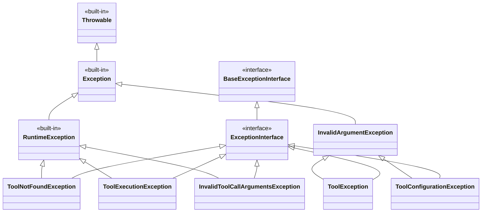

# Symfony AI Agent Toolbox Exception Class Hierarchy (Improved)

## Mermaid Class Diagram

## Changes from Previous Version

The improved version removed `ToolExecutionExceptionInterface` and refactored the hierarchy:
- All concrete exceptions now directly implement `ExceptionInterface`
- `ToolExecutionException` and `InvalidToolCallArgumentsException` provide execution results via `getToolCallResult()` method
- Simplified interface hierarchy while maintaining the same functionality
