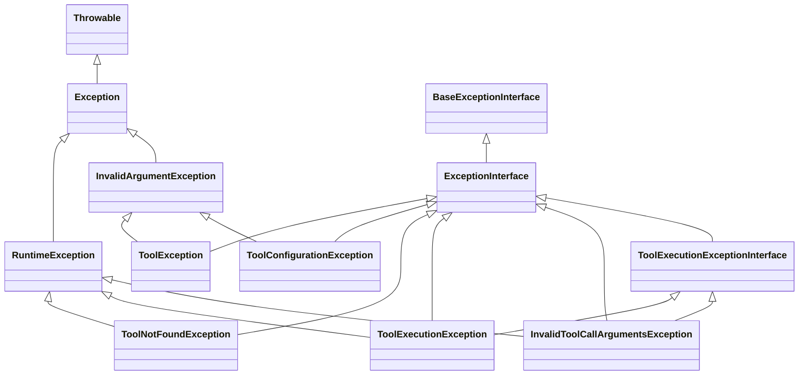

# Symfony AI Agent Toolbox Exception Class Hierarchy

## Mermaid Class Diagram

## Hierarchy Summary

### Base Layer (PHP Built-ins)
- `Throwable` - Root of PHP exception hierarchy
- `Exception` - Base exception class
- `RuntimeException` - Runtime errors

### Layer 1 (Symfony AI Agent Base)
- `BaseExceptionInterface` (from `Symfony\AI\Agent\Exception`) - Base exception interface
- `InvalidArgumentException` (from `Symfony\AI\Agent\Exception`) - For invalid argument errors

### Layer 2 (Toolbox Specific Interfaces)
- `ExceptionInterface` - Toolbox-specific marker interface (extends `BaseExceptionInterface`)
- `ToolExecutionExceptionInterface` - For execution errors (extends `ExceptionInterface`)
  - Defines: `getToolCallResult(): mixed`

### Layer 3 (Concrete Exception Classes)

#### Configuration/Setup Errors
- `ToolException` (extends `InvalidArgumentException` + `ExceptionInterface`)
  - For invalid tool references and missing attributes
- `ToolConfigurationException` (extends `InvalidArgumentException` + `ExceptionInterface`)
  - For invalid tool method configurations

#### Runtime/Execution Errors
- `ToolNotFoundException` (extends `RuntimeException` + `ExceptionInterface`)
  - For missing tools during execution
- `ToolExecutionException` (extends `RuntimeException` + `ToolExecutionExceptionInterface`)
  - For tool execution failures
- `InvalidToolCallArgumentsException` (extends `RuntimeException` + `ToolExecutionExceptionInterface`)
  - For invalid arguments passed to tool calls

## Key Observations

1. **Two Exception Hierarchies**: Configuration exceptions inherit from `InvalidArgumentException`, while execution exceptions inherit from `RuntimeException`
2. **Interface Compliance**: All exceptions implement `ExceptionInterface` or its sub-interfaces
3. **Tool Call Context**: Execution exceptions can carry `ToolCall` information
4. **Execution Result Access**: Execution exceptions implement `ToolExecutionExceptionInterface::getToolCallResult()`
