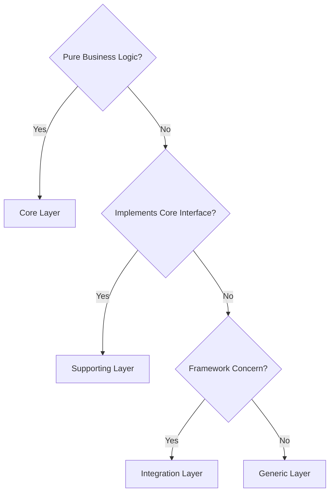

# Deptrac - Architecture Validation

## Overview

**Deptrac** is a static code analyzer that validates your codebase follows the defined architecture layers and dependency rules. It acts as an enforcer, preventing violations from entering the codebase.

## Why Deptrac?

- **Prevents architectural drift** - Ensures code follows the design
- **Catches violations early** - Validates at development time
- **Documents architecture** - Configuration serves as specification
- **Automated validation** - Part of CI/CD pipeline
- **Team alignment** - Shared understanding of layers

## Layer Structure

Momentum defines 5 layers in `app/deptrac.yaml`:

### Layers

```yaml
layers:
  - name: Core
    collectors:
      - type: classLike
        value: .*App\\Momentum\\.*
  
  - name: Generic
    collectors:
      - type: classLike
        value: .*Symfony\\.*
      - type: classLike
        value: .*Psr\\.*
      - type: classLike
        value: .*PHPUnit\\Framework\\.*
      - type: classLike
        value: .*Doctrine\\.*
  
  - name: Supporting
    collectors:
      - type: classLike
        value: .*App\\Strava\\.*
      - type: classLike
        value: .*App\\Repository\\.*
      - type: classLike
        value: .*App\\Listener\\.*
      - type: classLike
        value: .*App\\Command\\.*
      - type: classLike
        value: .*App\\Controller\\.*
      - type: classLike
        value: .*App\\Entity\\.*
      - type: classLike
        value: .*App\\Security\\.*
  
  - name: Tests
    collectors:
      - type: classLike
        value: .*App\\Tests\\.*
```

## Dependency Rules

### The Ruleset

```yaml
ruleset:
  Core: ~              # No dependencies allowed
  Generic: ~           # No dependencies allowed
  Supporting:
    - Core             # Can depend on Core
    - Generic          # Can depend on Generic
  Tests:
    - Core             # Can depend on all layers
    - Generic
    - Supporting
```

### Interpretation

| From | Can Depend On | Cannot Depend On |
|------|---------------|------------------|
| **Core** | (nothing) | Any layer (isolated) |
| **Generic** | (nothing) | Any layer (framework only) |
| **Supporting** | Core, Generic | Tests |
| **Tests** | Core, Generic, Supporting | (everything allowed) |
| **Integration** | Supporting, Generic | Core directly (violates) |

## Running Deptrac

### Check Architecture

```bash
# Quick architecture check
make arch

# Full QA suite (includes architecture)
make qa

# Verbose output
docker compose run --rm composer bin/deptrac analyze --no-ansi
```

### Interpreting Output

**Success**:
```
✓ No violations detected
```

**Violation Example**:
```
[ERROR] Violation
Class App\Core\MyClass (file: src/Core/MyClass.php)
depends on class App\Support\Helper (Support)
but only these layers are allowed: (no layers allowed)
```

This means:
- `App\Core\MyClass` is in the **Core** layer
- It depends on `App\Support\Helper` in the **Supporting** layer
- Core layer has no allowed dependencies (should be isolated)

## Common Violations & Fixes

### 1. Core Depends on Supporting

**Problem**:
```php
// src/Momentum/Calculator.php
namespace App\Momentum;

use App\Repository\ActivityRepository; // ❌ Supporting layer dependency

class Calculator
{
    public function calculate(ActivityRepository $repo)
    {
        // ...
    }
}
```

**Error**:
```
Violation: App\Momentum\Calculator depends on App\Repository\ActivityRepository
```

**Solutions**:

**Option A**: Extract repository dependency to interface in Core
```php
// src/Momentum/ActivityRepository.php (Core)
namespace App\Momentum;

interface ActivityRepository
{
    public function find(int $id): Activity;
}
```

**Option B**: Move logic to Supporting layer
```php
// src/Service/ActivityCalculator.php (Supporting)
namespace App\Service;

use App\Momentum\Calculator;
use App\Repository\ActivityRepository;

class ActivityCalculator
{
    public function __construct(
        private Calculator $calculator,
        private ActivityRepository $repository
    ) {}
    
    public function calculate(): void
    {
        // ...
    }
}
```

### 2. Integration Depends on Core Directly

**Problem**:
```php
// src/Controller/ActivityController.php
namespace App\Controller;

use App\Momentum\ActivityCalculator; // ❌ Direct Core dependency

class ActivityController
{
    public function index(ActivityCalculator $calc)
    {
        return $this->json($calc->analyze());
    }
}
```

**Solution**: Use Supporting layer service
```php
// src/Service/ActivityService.php (Supporting)
namespace App\Service;

use App\Momentum\ActivityCalculator;

class ActivityService
{
    public function __construct(private ActivityCalculator $calc) {}
    
    public function getAnalysis(): array
    {
        return $calc->analyze();
    }
}

// src/Controller/ActivityController.php
class ActivityController
{
    public function index(ActivityService $service)
    {
        return $this->json($service->getAnalysis());
    }
}
```

### 3. Circular Dependencies

**Problem**:
```
A → B → C → A (cycle detected)
```

**Solution**: Introduce abstraction
```
A → Interface ← B ← C
C → Interface ← A
```

### 4. Tests Depending Incorrectly

**Problem**: Tests should not depend on Integration layer
```php
// tests/Unit/CalculatorTest.php
use App\Repository\ActivityRepository; // ❌ Tests should test through Core

class CalculatorTest
{
    public function test(): void
    {
        $repo = $this->createMock(ActivityRepository::class);
        // ...
    }
}
```

**Solution**: Mock Core interfaces
```php
use App\Momentum\ActivityRepository; // ✓ Core interface

class CalculatorTest
{
    public function test(): void
    {
        $repo = $this->createMock(ActivityRepository::class);
        // ...
    }
}
```

## Adding New Classes

### Decide the Layer



### Add to Deptrac Configuration

Edit `app/deptrac.yaml`:

```yaml
layers:
  - name: MyNewLayer
    collectors:
      - type: classLike
        value: .*App\\MyNewLayer\\.*
```

Update ruleset:
```yaml
ruleset:
  MyNewLayer:
    - Core
    - Generic
```

### Validate

```bash
make arch
```

## Best Practices

✓ **Do**:
- Keep Core layer completely isolated
- Use interfaces for dependencies
- Run `make arch` before committing
- Update Deptrac config when adding layers
- Include `make arch` in CI/CD pipeline

✗ **Don't**:
- Add exceptions to Deptrac rules (fix violations instead)
- Create circular dependencies
- Let violations accumulate
- Skip architecture validation
- Move classes between layers carelessly

## Troubleshooting

### "Violation detected" but code looks correct

```bash
# Clear cache and re-run
make cc && make arch

# Check the exact error
docker compose run --rm composer bin/deptrac analyze
```

### Deptrac is too strict

Instead of loosening Deptrac rules (which defeats the purpose), refactor:

1. **Extract an interface** - Define contract in Core
2. **Create an adapter** - Implement in Supporting
3. **Use dependency injection** - Inject the adapter

### Performance issues with large codebases

```bash
# Add skip-violations to improve performance
docker compose run --rm composer bin/deptrac analyze --skip-violations
```

## Integration with Development

### Pre-commit Hook

Add to `.git/hooks/pre-commit`:
```bash
#!/bin/bash
make arch || exit 1
```

### CI/CD Pipeline

```yaml
# .gitlab-ci.yml
architecture:
  stage: validate
  script:
    - make arch
```

### IDE Integration

- PHPStorm: Install Deptrac plugin
- VS Code: Use extension marketplace (search "deptrac")

## Resources

- [Deptrac Official Docs](https://deptrac.readthedocs.io/)
- [Clean Architecture](https://blog.cleancoder.com/uncle-bob/2012/08/13/the-clean-architecture.html)
- [Hexagonal Architecture](https://alistair.cockburn.us/hexagonal-architecture/)
