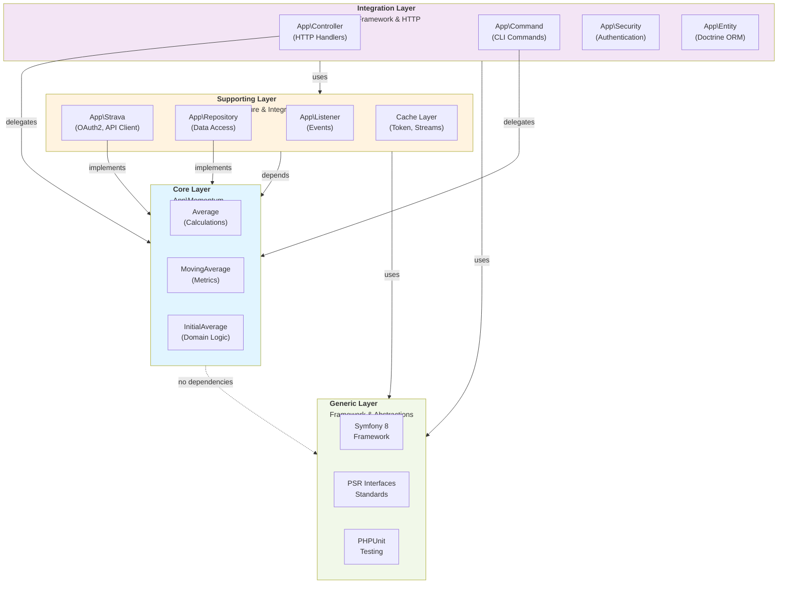
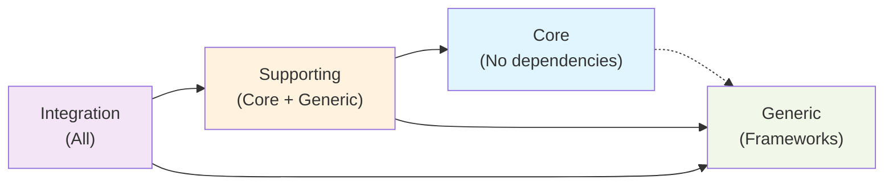
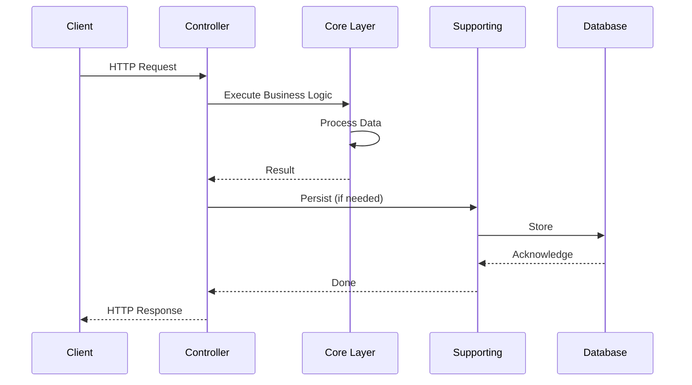
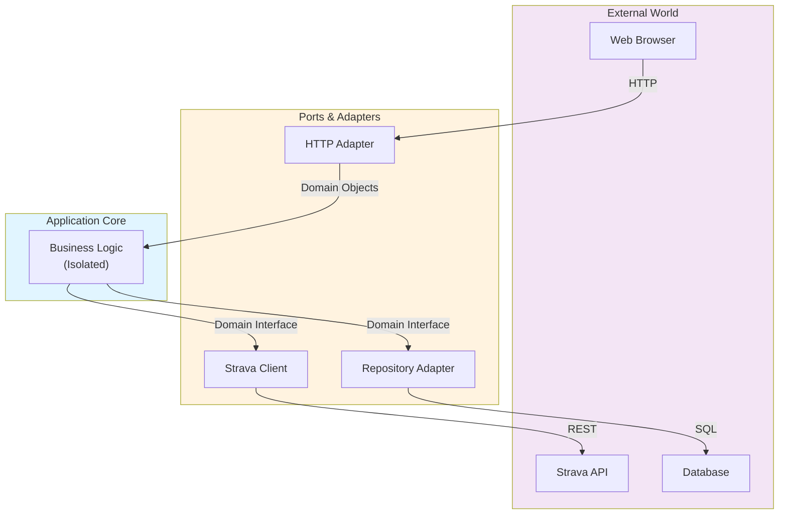

# Architecture

## Overview

Momentum follows a **clean architecture** pattern organized into logical layers, enforced by **Deptrac**. This design ensures business logic remains independent of frameworks and external dependencies, making the codebase maintainable, testable, and scalable.



### Layer Dependencies

Dependency flow follows a strict hierarchy:



## Layer Details

### Core Layer (`App\Momentum`)

**Purpose**: Pure domain logic and business rules

**Characteristics**:
- Framework-agnostic
- No external dependencies
- Highly testable
- Contains business value

**Components**:
- **`Average`**: Calculates average values from datasets
- **`MovingAverage`**: Computes moving averages (e.g., 7-day, 30-day metrics)
- **`InitialAverage`**: Provides initial average calculations for baseline analysis
- Domain models representing running metrics and analysis

**Rules**:
- ✓ Pure functions and value objects
- ✓ Testable without infrastructure
- ✗ No Symfony dependencies
- ✗ No database access
- ✗ No HTTP calls

**Example**:
```php
// Core layer - pure business logic
final readonly class MovingAverage
{
    public function __construct(private array $values) {}
    
    public function calculate(int $windowSize): float
    {
        // Pure calculation logic - no external dependencies
        return array_sum(array_slice($this->values, -$windowSize)) / $windowSize;
    }
}
```

---

### Supporting Layer

**Purpose**: Infrastructure, integrations, and adapters

**Characteristics**:
- Implements Core layer interfaces
- Handles external services
- Database access via repositories
- Dependency injection adapters

**Components**:

#### `App\Strava` - External API Integration
- **`Client`**: HTTP client for Strava API v3
- **`Configuration`**: OAuth2 credentials management
- **`TokenCache`**: Persists and refreshes OAuth tokens locally
- **`Synchronizer`**: Syncs running activities from Strava
- **`ActivityStreamCache`**: Caches detailed stream data (elevation, pace, etc.)

#### `App\Repository` - Data Access
- Implements Doctrine ORM queries
- Returns domain models from database
- Abstracts database details from Core

#### Other Supporting Components
- `App\Listener`: Event subscribers for async operations
- `App\Async`: Background job handlers
- `App\Twig`: View helpers (not business logic)

**Rules**:
- ✓ Depends on Core layer
- ✓ Depends on Generic (Symfony, PSR)
- ✓ Implements Core interfaces
- ✗ No Controllers or Commands
- ✗ Never used by Integration directly (use through Core)

**Example**:
```php
// Supporting layer - implements domain interface
final class ActivityRepository implements ActivityRepositoryInterface
{
    // Implements interface from Core layer
    public function findActivityById(int $id): RunningActivity
    {
        $entity = $this->em->find(ActivityEntity::class, $id);
        // Convert Doctrine entity to domain model
        return $this->toDomain($entity);
    }
}
```

---

### Integration Layer

**Purpose**: Framework-specific concerns and HTTP/CLI interfaces

**Characteristics**:
- Translates external input to domain operations
- Handles HTTP requests and CLI commands
- Orchestrates infrastructure
- Framework-dependent

**Components**:

#### `App\Controller` - HTTP Endpoints
- Handle incoming web requests
- Delegate to Core/Supporting layers
- Return HTTP responses

#### `App\Command` - CLI Commands
- CLI interface for operations
- Run background tasks
- Invoke Core logic

#### `App\Security` - Authentication
- OAuth2 authentication providers
- Authorization logic
- Session handlers

#### `App\Entity` - Doctrine ORM
- Database mapping (Doctrine attributes)
- Entity relationships
- Persistence configuration

#### `App\Middleware` - HTTP Middleware
- Request/response processing
- Authentication checks
- Error handling

**Rules**:
- ✓ Depends on Supporting + Core layers
- ✓ Handles framework concerns
- ✓ Translates HTTP ↔ Domain operations
- ✗ No business logic
- ✗ Minimal complexity

**Example**:
```php
// Integration layer - HTTP handler
#[Route('/activities', methods: ['GET'])]
public function list(ActivityService $service): Response
{
    // Delegate to Core/Supporting
    $activities = $service->getRecentActivities();
    
    // Format response
    return $this->json($activities);
}
```

---

### Generic Layer

**Purpose**: Framework and standard library abstractions

**Contains**:
- Symfony framework classes
- PSR interfaces (PSR-3 Logger, PSR-11 Container, etc.)
- PHPUnit testing framework
- PHP standard library

**Characteristics**:
- Used by all layers
- Provides infrastructure abstractions
- Not specific to Momentum domain

---

### Test Layer (`App\Tests`)

**Purpose**: Validate business logic

**Characteristics**:
- Can depend on all layers
- Focuses on Core layer testing
- Unit tests for domain models
- High code coverage target

**Structure**:
- `tests/Unit/` - Unit tests
- Tests organized by namespace
- Mock external dependencies

**Example**:
```php
// Test layer - validates Core behavior
#[Test]
public function movingAverageCalculatesCorrectly(): void
{
    $values = [1, 2, 3, 4, 5];
    $ma = new MovingAverage($values);
    
    self::assertEquals(3.0, $ma->calculate(3));
}
```

---

## Architecture Validation with Deptrac

### What is Deptrac?

**Deptrac** is a static code analyzer that enforces architecture rules. It validates that your code follows the defined layer structure by checking dependencies.

### Configuration

Rules defined in `app/deptrac.yaml`:

```yaml
ruleset:
  Core: ~                    # Isolated - no dependencies
  Generic: ~                 # Isolated - no dependencies
  Supporting:
    - Core                   # Can depend on Core
    - Generic                # Can depend on Generic
  Tests:
    - Core                   # Can depend on all
    - Generic
    - Supporting
```

### Running Validation

```bash
# Architecture check only
make arch

# Full QA suite (includes architecture check)
make qa
```

### Fixing Violations

When Deptrac reports violations:

1. **Read the error** - identifies forbidden dependency
2. **Analyze the code** - understand why the dependency exists
3. **Refactor**:
   - Move class to correct layer
   - Extract Core logic from Supporting
   - Use dependency injection
   - Define interfaces
4. **Re-validate** - `make arch`

**Common violations**:
- Core depends on Supporting → Extract logic to Core
- Supporting depends on Integration → Move classes appropriately
- Circular dependencies → Introduce interface

---

## Documenting Architecture with MkDocs & Mermaid

### Mermaid Diagrams

Create visual representations of architecture using Mermaid:



### When to Add Diagrams

- New architectural patterns
- Complex data flows
- Layer interactions
- Integration points
- Feature architecture

### MkDocs Configuration

Mermaid is enabled in `mkdocs.yaml`:

```yaml
markdown_extensions:
  - pymdownx.superfences:
      custom_fences:
        - name: mermaid
          class: mermaid
          format: !!python/name:pymdownx.superfences.fence_code_format
```

---

## Technology Stack

| Component | Technology | Version |
|-----------|-----------|---------|
| **Language** | PHP | 8.4+ |
| **Framework** | Symfony | 8.x |
| **Database** | MySQL | 8.4 |
| **ORM** | Doctrine | Latest |
| **External API** | Strava API | v3 |
| **Testing** | PHPUnit | Latest |
| **Static Analysis** | PHPStan | Level 8 (max) |
| **Code Style** | PHP-CS-Fixer | Symfony rules |
| **Architecture** | Deptrac | Latest |
| **Documentation** | MkDocs | Material theme |
| **Diagrams** | Mermaid | Via Superfences |

---

## Design Principles

### SOLID Principles

1. **Single Responsibility** - Each class has one reason to change
2. **Open/Closed** - Open for extension, closed for modification
3. **Liskov Substitution** - Subtypes must be substitutable
4. **Interface Segregation** - Don't depend on interfaces you don't use
5. **Dependency Inversion** - Depend on abstractions, not concretions

### Hexagonal Architecture



---

## Best Practices

✓ **Do**:
- Keep Core layer pure and framework-free
- Use dependency injection for flexibility
- Write tests for Core layer
- Document complex domain logic
- Update diagrams when architecture changes
- Run `make arch` before committing

✗ **Don't**:
- Put framework code in Core layer
- Create tight coupling between layers
- Skip architecture validation
- Have circular dependencies
- Mix concerns in single class
- Ignore architecture violations

---

## Learning Resources

- **Clean Architecture** - Robert C. Martin
- **Domain-Driven Design** - Eric Evans
- **Hexagonal Architecture** - Alistair Cockburn
- [Deptrac Documentation](https://deptrac.readthedocs.io/)
- [Symfony Best Practices](https://symfony.com/doc/current/best_practices.html)
- [MkDocs Documentation](https://www.mkdocs.org/)
