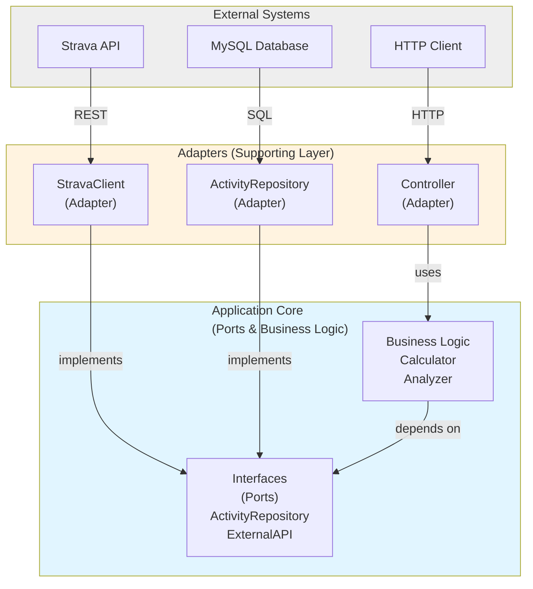
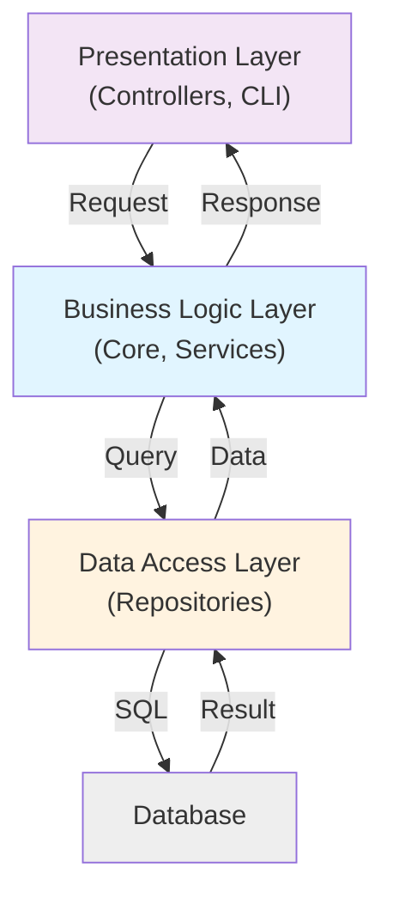

# Design Patterns & Best Practices

## Architectural Patterns

### Hexagonal Architecture (Ports & Adapters)

Hexagonal architecture isolates business logic at the center with adapters handling external interactions.



**Benefits**:
- Business logic independent of frameworks
- Easy to test (mock adapters)
- Easy to swap implementations
- Clear boundaries

### Layered Architecture



## PHP Coding Patterns

### Value Objects

Value objects represent immutable domain concepts.

```php
// ✓ Good: Value object pattern
final readonly class Pace
{
    private function __construct(
        private int $minutesPerKm,
        private int $secondsPerKm
    ) {
        assert($minutesPerKm >= 0);
        assert($secondsPerKm < 60);
    }
    
    public static function fromSeconds(int $seconds): self
    {
        return new self(
            (int) ($seconds / 60),
            $seconds % 60
        );
    }
    
    public function toSeconds(): int
    {
        return $this->minutesPerKm * 60 + $this->secondsPerKm;
    }
    
    public function isFaster(self $other): bool
    {
        return $this->toSeconds() < $other->toSeconds();
    }
}

// Usage
$pace1 = Pace::fromSeconds(300); // 5:00 per km
$pace2 = Pace::fromSeconds(360); // 6:00 per km

if ($pace1->isFaster($pace2)) {
    echo "Pace 1 is faster";
}
```

### Immutable Wither Pattern

Methods that "update" a value object return a new instance.

```php
final readonly class TrainingSession
{
    public function __construct(
        private int $durationSeconds,
        private Pace $averagePace,
        private array $heartRates = []
    ) {}
    
    // ✓ Returns new instance (immutable)
    public function withHeartRate(int $bpm): self
    {
        return new self(
            $this->durationSeconds,
            $this->averagePace,
            [...$this->heartRates, $bpm]
        );
    }
    
    // ✓ Wither for composition
    public function withAveragePace(Pace $pace): self
    {
        return new self(
            $this->durationSeconds,
            $pace,
            $this->heartRates
        );
    }
}

$session = new TrainingSession(3600, $pace);
$updated = $session->withHeartRate(150);  // New instance
// $session remains unchanged
```

### Functional Pipelines

```php
// ✓ Prefer functional composition
final class ActivityAnalyzer
{
    public function filterByDistance(array $activities, float $minKm): array
    {
        return array_filter($activities, fn($a) => $a->distanceKm >= $minKm);
    }
    
    public function sortByPace(array $activities): array
    {
        return array_sort($activities, fn($a, $b) => 
            $a->pace <=> $b->pace
        );
    }
    
    public function calculateStats(array $activities): Stats
    {
        // Reduce pattern
        return array_reduce(
            $activities,
            function (Stats $stats, Activity $activity): Stats {
                return $stats->addActivity($activity);
            },
            Stats::empty()
        );
    }
}

// ✓ Generators for large datasets
final class ActivityRepository
{
    public function yieldActivitiesInRange(
        \DateTimeImmutable $start,
        \DateTimeImmutable $end
    ): \Generator {
        $chunk = 100;
        $offset = 0;
        
        while (true) {
            $activities = $this->queryChunk($start, $end, $offset, $chunk);
            if (empty($activities)) break;
            
            foreach ($activities as $activity) {
                yield $activity;
            }
            
            $offset += $chunk;
        }
    }
}

// Usage
$repo = new ActivityRepository();
$stats = array_reduce(
    iterator_to_array($repo->yieldActivitiesInRange($start, $end)),
    fn(Stats $s, Activity $a) => $s->addActivity($a),
    Stats::empty()
);
```

### Behavior Belongs to Domain Objects

Push logic into the class it concerns rather than static helpers.

```php
// ❌ Anti-pattern: Helper class
class PaceCalculator
{
    public static function calculate(Activity $activity): int
    {
        return $activity->distanceM / $activity->durationS;
    }
}

// ✓ Good: Behavior in domain object
final readonly class Activity
{
    public function __construct(
        private int $distanceM,
        private int $durationS
    ) {}
    
    public function calculatePace(): Pace
    {
        return Pace::fromMetersPerSecond(
            $this->distanceM / $this->durationS
        );
    }
}
```

### Decomposition

Split complex classes into focused, single-responsibility classes.

```php
// ❌ Too many responsibilities
class ActivityAnalysis
{
    public function analyzeActivity(Activity $activity): array
    {
        // Calculates zones
        // Analyzes pace variations
        // Generates reports
        // 200+ lines...
    }
}

// ✓ Decomposed into focused classes
final class ZoneAnalysis
{
    public function analyze(Activity $activity): array { }
}

final class PaceAnalysis
{
    public function analyze(Activity $activity): array { }
}

final class HeartRateAnalysis
{
    public function analyze(Activity $activity): array { }
}

final class ActivityAnalyzer
{
    public function __construct(
        private ZoneAnalysis $zones,
        private PaceAnalysis $pace,
        private HeartRateAnalysis $hr
    ) {}
    
    public function analyze(Activity $activity): Analysis
    {
        return new Analysis(
            zones: $this->zones->analyze($activity),
            pace: $this->pace->analyze($activity),
            hr: $this->hr->analyze($activity)
        );
    }
}
```

### Encapsulation

Never expose mutable state as public properties.

```php
// ❌ Broken encapsulation
class Runner
{
    public array $sessions = [];  // Mutable, exposed
}

// ✓ Encapsulated with getter
final readonly class Runner
{
    public function __construct(
        private array $sessions = []
    ) {}
    
    public function getSessions(): array
    {
        return $this->sessions;
    }
    
    public function addSession(Session $session): self
    {
        return new self([...$this->sessions, $session]);
    }
}
```

### Assertions & Invariants

Use assertions to document and enforce type contracts.

```php
final class HeartRateZone
{
    public function __construct(
        private int $minBpm,
        private int $maxBpm
    ) {
        assert($minBpm > 0, 'Minimum BPM must be positive');
        assert($maxBpm > $minBpm, 'Maximum must exceed minimum');
        assert($maxBpm <= 220, 'Maximum BPM should not exceed 220');
    }
    
    public function contains(int $bpm): bool
    {
        assert($bpm > 0, 'BPM must be positive');
        return $bpm >= $this->minBpm && $bpm <= $this->maxBpm;
    }
}
```

## Service Layer Patterns

### Use Case / Application Service

```php
// Supporting layer: orchestrates Core + infrastructure
final class SyncActivitiesFromStrava
{
    public function __construct(
        private StravaClient $client,
        private ActivityRepository $repository,
        private ActivityFactory $factory
    ) {}
    
    public function execute(): void
    {
        // Get from external API
        $rawtivities = $this->client->fetchRecent();
        
        // Create domain models
        $activities = array_map(
            fn($raw) => $this->factory->create($raw),
            $rawActivities
        );
        
        // Persist using repository
        foreach ($activities as $activity) {
            $this->repository->save($activity);
        }
    }
}

// Integration layer: expose through command/controller
final class SyncCommand extends Command
{
    public function __construct(
        private SyncActivitiesFromStrava $sync
    ) {}
    
    protected function execute(InputInterface $input, OutputInterface $output)
    {
        $this->sync->execute();
        $output->writeln('✓ Synced activities');
    }
}
```

### Repository Pattern

```php
// Core: Define interface in Core layer
namespace App\Momentum;

interface ActivityRepository
{
    public function find(int $id): Activity;
    public function findAll(): array;
    public function save(Activity $activity): void;
}

// Supporting: Implement with Doctrine
namespace App\Repository;

use App\Momentum\ActivityRepository;
use Doctrine\ORM\EntityRepository;

final class DoctrineActivityRepository extends EntityRepository implements ActivityRepository
{
    public function find(int $id): Activity
    {
        $entity = parent::find($id);
        return $this->toDomain($entity);
    }
    
    private function toDomain(ActivityEntity $entity): Activity
    {
        return new Activity(
            id: $entity->id,
            // ... map fields
        );
    }
}
```

## Dependency Injection

### Constructor Injection (Preferred)

```php
// ✓ Good: Dependencies explicit
final class ActivityAnalyzer
{
    public function __construct(
        private ActivityRepository $repository,
        private Calculator $calculator
    ) {}
    
    public function analyze(int $activityId): Analysis
    {
        $activity = $this->repository->find($activityId);
        return $this->calculator->analyze($activity);
    }
}
```

### Avoiding Service Locator Pattern

```php
// ❌ Anti-pattern: Service locator (hidden dependencies)
final class ActivityAnalyzer
{
    public function analyze(int $activityId): Analysis
    {
        $repo = ServiceLocator::get(ActivityRepository::class);
        $calc = ServiceLocator::get(Calculator::class);
        
        $activity = $repo->find($activityId);
        return $calc->analyze($activity);
    }
}

// ✓ Good: Explicit constructor injection
final class ActivityAnalyzer
{
    public function __construct(
        private ActivityRepository $repository,
        private Calculator $calculator
    ) {}
    
    public function analyze(int $activityId): Analysis
    {
        // Clear what this class depends on
        return $this->calculator->analyze(
            $this->repository->find($activityId)
        );
    }
}
```

## Anti-Patterns to Avoid

### Feature Envy

```php
// ❌ Method knows too much about another class
class PaceValidator
{
    public function isValid(Activity $activity): bool
    {
        return $activity->getDurationSeconds() > 0
            && $activity->getDistanceMeters() > 0
            && ($activity->getDistanceMeters() / $activity->getDurationSeconds()) < 10;
    }
}

// ✓ Move behavior to domain object
final class Activity
{
    public function isValidPace(): bool
    {
        return $this->pace > 0 && $this->pace < 10;
    }
}
```

### Data Classes

```php
// ❌ Just a bag of getters/setters (anemic model)
class RunningSession
{
    private $duration;
    private $distance;
    private $pace;
    
    public function setDuration($d) { $this->duration = $d; }
    public function getDuration() { return $this->duration; }
    // ... more getters/setters
}

// ✓ Rich domain model with behavior
final readonly class RunningSession
{
    public function __construct(
        private Duration $duration,
        private Distance $distance
    ) {}
    
    public function calculatePace(): Pace
    {
        return Pace::fromMetersPerSecond(
            $this->distance->meters / $this->duration->seconds
        );
    }
    
    public function isCoreWorkout(): bool
    {
        return $this->duration->seconds > 1800
            && $this->calculatePace()->isInZone(Zone::Threshold);
    }
}
```

### God Classes

```php
// ❌ Class does too much
class ActivityManager
{
    public function createActivity() { }
    public function updateActivity() { }
    public function deleteActivity() { }
    public function analyzeActivity() { }
    public function syncFromStrava() { }
    public function exportToFile() { }
    // 500+ lines
}

// ✓ Decomposed into focused services
class ActivityCreator { }
class ActivityUpdater { }
class ActivityAnalyzer { }
class StravaSync { }
class ActivityExporter { }
```

## Testing Patterns

### Test Structure: Arrange-Act-Assert

```php
#[Test]
public function calculatesPaceCorrectly(): void
{
    // Arrange
    $activity = new Activity(
        distance: 10000,      // 10km
        duration: 3600        // 1 hour
    );
    
    // Act
    $pace = $activity->calculatePace();
    
    // Assert
    self::assertEquals(360, $pace->secondsPerKilometer());
}
```

### Mocking External Dependencies

```php
#[Test]
public function syncsActivitiesFromStrava(): void
{
    // Mock external dependency
    $stravasClient = $this->createMock(StravaClient::class);
    $stravasClient->expects(self::once())
        ->method('fetchRecent')
        ->willReturn([
            ['id' => 1, 'distance' => 10000, 'duration' => 3600],
        ]);
    
    $repository = $this->createMock(ActivityRepository::class);
    $repository->expects(self::once())
        ->method('save');
    
    $sync = new SyncActivitiesFromStrava($stravasClient, $repository);
    $sync->execute();
}
```

## Performance Considerations

### Pagination for Large Datasets

```php
final class ActivityRepository
{
    public function findRecent(int $page = 1, int $limit = 50): Paginator
    {
        return $this->createQueryBuilder('a')
            ->orderBy('a.createdAt', 'DESC')
            ->setFirstResult(($page - 1) * $limit)
            ->setMaxResults($limit)
            ->getQuery()
            ->getResult();
    }
}
```

### Lazy Loading with Generators

```php
public function yieldActivities(): \Generator
{
    $batch = 100;
    $offset = 0;
    
    while (true) {
        $results = $this->query($offset, $batch);
        if (empty($results)) break;
        
        foreach ($results as $item) {
            yield $item;
        }
        
        $offset += $batch;
    }
}
```

## Checklist for New Features

- [ ] Define domain model (Core)
- [ ] Create domain interfaces (Core)
- [ ] Implement repositories (Supporting)
- [ ] Implement external service clients (Supporting)
- [ ] Create use case service (Supporting)
- [ ] Add controller/command (Integration)
- [ ] Write tests for Core logic
- [ ] Run `make arch` (validation passes)
- [ ] Run `make cs` (code style)
- [ ] Run `make test` (all tests pass)
- [ ] Update documentation
