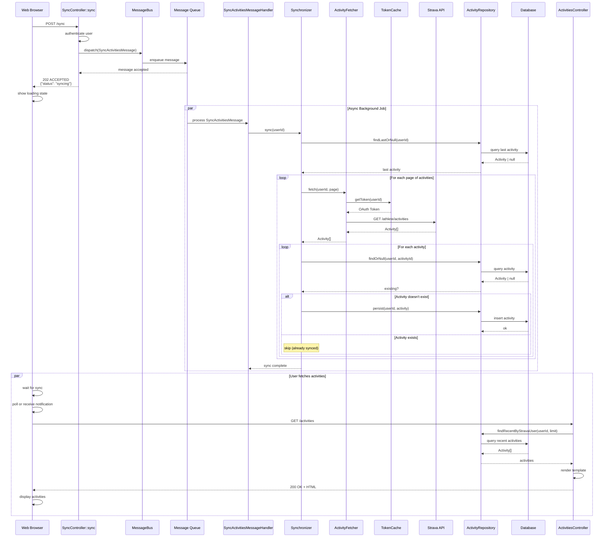
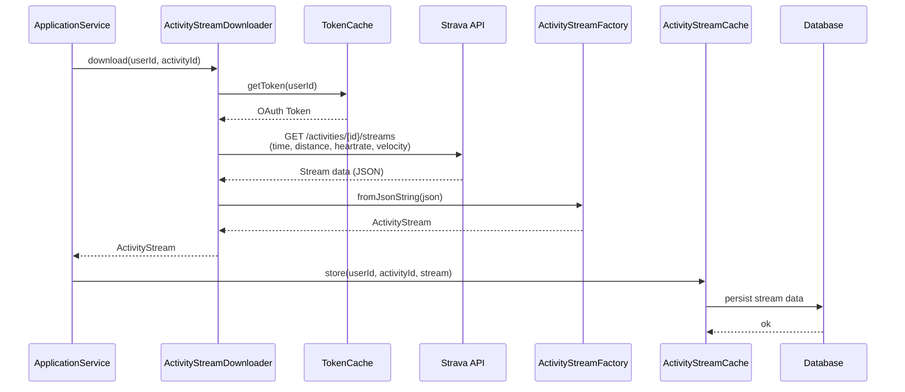
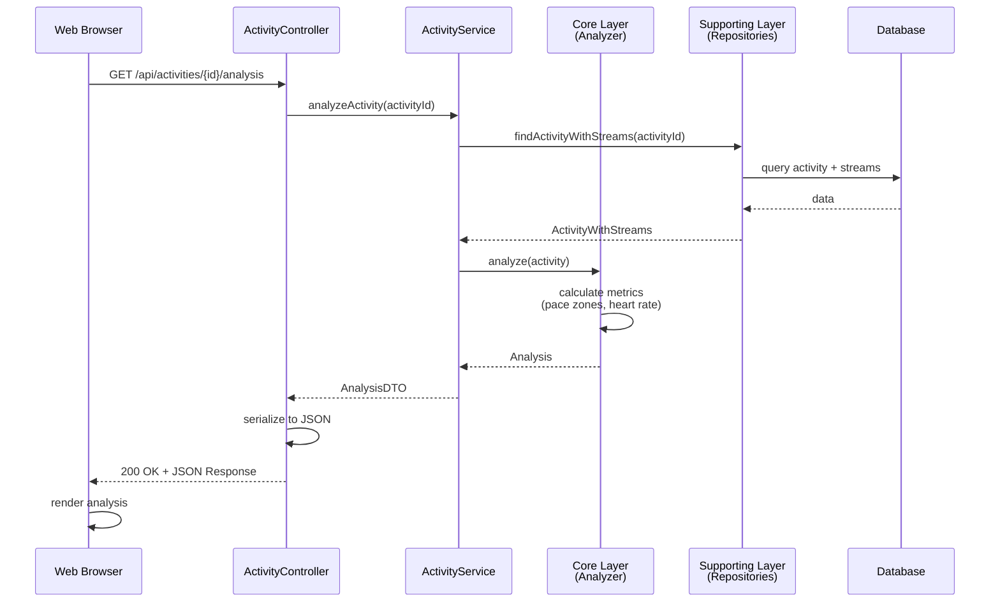

# Strava API Integration Flow

## Activity Synchronization Flow (UI Perspective)

## Activity Stream Download Flow

## Complete Request-Response Cycle (Web)

## Layer Mapping

| Layer | Component | Responsibility |
|-------|-----------|-----------------|
| **Integration** | FetchActivitiesCommand | CLI entry point, orchestrates sync |
| **Supporting** | Synchronizer | Coordinates fetching and persistence |
| **Supporting** | ActivityFetcher | HTTP calls to Strava API |
| **Supporting** | ActivityStreamDownloader | Downloads stream data from Strava |
| **Supporting** | ActivityRepository | Data access layer |
| **Supporting** | TokenCache | Token management |
| **Core** | Activity, ActivityStream | Domain models |
| **Generic** | HttpClientInterface, Symfony | Framework abstraction |
